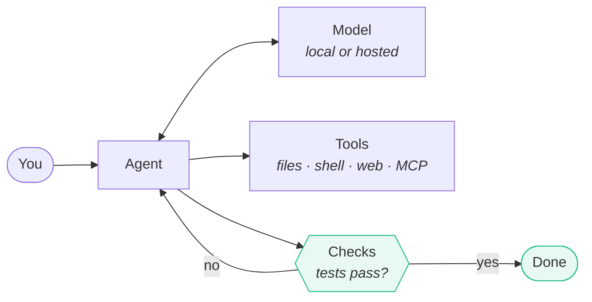

<p align="center">
  
</p>

<h1 align="center">Chanto</h1>

<p align="center">
  A fast, lean coding agent for your terminal.
  Any model, local or hosted, including your cloud's:
  Amazon Bedrock, Google Vertex AI and Azure.
</p>

<p align="center">
  
  <a href="https://scorecard.dev/viewer/?uri=github.com/chanto-sh/chanto"></a>
  <a href="https://www.bestpractices.dev/projects/15833"></a>
  
  
</p>

> [!NOTE]
> **Chanto is in alpha:** expect rough edges and breaking changes before 1.0.
> It's built by one developer with a lot of help from AI coding agents; CI runs
> the tests on Linux, macOS and Windows, and the [security model](docs/security-model.md)
> explains how it protects you. [Issues](https://github.com/chanto-sh/chanto/issues)
> and feedback are welcome. Switching from another agent? Chanto reads the config
> you already have.

<p align="center">
  <a href="docs/reference.md"><b>Docs</b></a> ·
  <a href="https://chanto.sh/docs/quickstart"><b>Quickstart</b></a> ·
  <a href="https://github.com/chanto-sh/benchmarks/blob/main/RESULTS.md"><b>Benchmarks</b></a> ·
  <a href="CHANGELOG.md"><b>Changelog</b></a>
</p>

---

## Install

```sh
curl -fsSL https://chanto.sh/install.sh | sh      # macOS and Linux
brew install chanto-sh/tap/chanto                 # Homebrew
npm i -g @chanto/cli                              # npm
cargo install chanto --locked                     # from source (Rust 1.95+)
```

On Windows (PowerShell): `irm https://chanto.sh/install.ps1 | iex`. The installers check the release signature and the download's checksum and put `chanto` in `~/.local/bin`; `chanto upgrade` updates it.

## First run

```sh
cd your-project
chanto
```

Chanto looks for what you already have: API keys in your environment, your Codex config, a running Ollama. Then it asks you to pick a model. No keys? Pick one of the free options: OpenRouter's free models, Gemini's free tier, or a model on your own machine. [Hosted models](docs/reference.md#hosted-models) covers every provider, including your ChatGPT plan, Amazon Bedrock, Google Vertex AI and Azure.

Then just say what you want, like "fix the failing test in auth". Chanto asks before editing files or running risky commands, unless you allow them.

`chanto setup` changes the default model later, and `chanto doctor` shows what was found and where each setting came from.

## Everyday use

```sh
chanto                               # a session in this project
chanto "explain the auth flow"       # start with a prompt
chanto -p "fix the failing tests"    # run once and print the result (scripts, CI)
chanto --verify "add a login page"   # can't finish until the project's tests pass
chanto -c                            # continue the last session here
chanto --worktree                    # work in a new checkout and branch, for parallel sessions
chanto --inline                      # print into your terminal's scrollback instead of full screen
```

In a session:

| | |
|---|---|
| `esc` | stop the model |
| `enter` while it works | the model gets your message at its next step (`ctrl+x ctrl+s` sends now, `ctrl+x enter` waits for the turn to end) |
| `esc esc` or `/rewind` | go back to an earlier prompt (undoing file changes too), or edit one to start a new branch; `/redo` puts back what you undid |
| `/model`, `/effort` | switch model, or set how hard it thinks |
| `shift+tab` | cycle permission mode (ask, accept edits, plan, auto) |
| `@file`, `!cmd` | attach a file; run a shell command yourself |
| `?` or `/help` | all keys and commands |

`chanto --help` lists the command-line options and subcommands. The [reference](docs/reference.md) covers the rest.

---

## Features

| | |
|---|---|
| **Fast and lean** | One native binary that starts instantly and stays light on CPU and memory while it works ([benchmarks](#benchmarks)) |
| **Any model** | Free to start (OpenRouter's free models, Gemini's free tier, or a local model); Ollama, llama.cpp, vLLM and other OpenAI-compatible servers; OpenAI, Anthropic, OpenRouter, DeepSeek and more; your ChatGPT login; Amazon Bedrock, Google Vertex AI and Azure with your cloud credentials |
| **Safe by default** | Shell commands run in a sandbox on macOS and Linux (on Windows it confines writes only: reads and network aren't restricted), with optional network domain allowlists on macOS and Linux; risky actions need your OK, and auto mode screens commands for you |
| **Undo** | `/rewind` restores files (including what shell commands changed) and the conversation to any earlier prompt |
| **Outcome mode** | Agree on what "done" means first, then review results instead of code |
| **Background runs** | `chanto run --bg "<task>"` (or `&task` in the TUI) works in its own git worktree and branch while you keep going; `chanto runs`, `attach` to answer prompts, `apply` to bring the result over; optional per-run Docker/Podman container for its commands (`[background] isolate = "docker"`, no network or an allowlist, CPU/memory limits) |
| **Checks its work** | Runs the tests related to its change before saying it's done (the full suite when shared setup changed, or with `--verify-full`), tells failures it caused from ones that were already there, and won't weaken tests to pass |
| **Finds its way in big repos** | `RepoMap` gives a ranked, token-budgeted map of the project's symbols; `SemanticSearch` finds code by meaning through `[embeddings]` (a local Ollama model by default). Both are read-only, so they run without a prompt |
| **Plays well with others** | MCP, hooks, and Claude Code plugin marketplaces (`chanto plugin`) |

<details>
<summary><b>Everything else</b>: goals, teams, scheduled jobs, memory, voice and more</summary>

| | |
|---|---|
| **Goals** | `/goal <objective>` keeps working across turns and context windows until the agreed, locked criteria pass; stops on limits or no progress, and asks when blocked |
| **Teams** | `/team <task>` splits work into parallel sub-tasks in their own worktrees, reviews each one, merges them onto a team branch and runs your checks |
| **Costs and diagnostics** | USD totals, session/daily budgets, a spend guard that estimates fan-out before it starts and explains costly loops, redacted daily logs, opt-in OTLP telemetry, `/feedback`, and opt-in error reports |
| **Keeps secrets out** | Hides API keys and `.env` values from the model and logs |
| **Durable memory** | Remembers user preferences and project facts across sessions, with visible saves and undo |
| **Local models** | Tuned for small local models, and won't run your machine out of memory |
| **Easy to install** | One-line installers that verify checksums, optional daily update notices, and `chanto upgrade` |
| **Chanto cloud** | `chanto login cloud`, then models as `chanto/<model>` and agents that run on a schedule, on GitHub events or from CI: `chanto agents create`, `chanto agents run --wait`, `chanto cloud run --agent <name>` with `CHANTO_CLOUD_TOKEN` ([docs](docs/reference.md#chanto-cloud)) |
| **Scheduled jobs** | `chanto runner`: cron, interval, webhook and CI triggers, each an isolated background run with budgets, verification and notifications |
| **Drive another agent** | `chanto acp-client <command>` runs any ACP agent (Claude Code via `claude-agent-acp`, OpenCode, …) with Chanto's UI, permissions and your MCP servers; the agent can run commands through Chanto's terminals, its modes, settings and sign-in work through `/agent-mode`, `/agent-config` and `/agent-login`, and its own slash commands are passed through ([docs](docs/reference.md#driving-another-agent-acp-client)) |
| **Learns from you** | Suggests lessons from your corrections, only applied when you approve |
| **Customizable** | Ask `/customize` or `chanto customize` to add commands, skills, hooks and more; `/reload` applies extensions |
| **Computer use** | Opt-in (`--computer`) desktop control beyond the browser: screenshots, clicks, typing and apps on macOS (built-in tools only) and Linux (X11, or Wayland with grim/GNOME/KDE screenshots and ydotool); every action needs your approval, and a status-line indicator shows it's on |
| **Remote runs** | `chanto serve --runs` on your own server, then `chanto run --bg --on <server>`: the code goes as a git bundle or through your git remote, and the results come back the same way |
| **Sessions** | Resume from any directory, fork current or past conversations, browse session trees, share redacted standalone HTML, and import sessions others share with you (`chanto import-session`) |
| **Voice input** | ctrl+space or `/voice` in the TUI: dictate a prompt, transcribed locally with whisper.cpp (or a hosted endpoint you configure) and placed in the prompt for review ([docs](docs/reference.md#voice-input)) |
| **Your terminal, your way** | A full-screen view, or `--inline` to print into your terminal's own scrollback (native scroll, search and copy); Markdown renders as it streams; `/effort` sets how hard the model thinks |

Full list in the [docs](docs/reference.md).
</details>

<details>
<summary><b>Compatibility: the existing Claude Code and Codex setup it reads</b></summary>

| Reads | From |
|---|---|
| Settings, permission rules, hooks, env, status line, output style, API key helper | `~/.claude/settings.json`, `.claude/settings*.json` |
| MCP servers | `.mcp.json`, `~/.claude.json`, Codex `config.toml` |
| Instructions | `AGENTS.md`, `AGENTS.override.md`, `CLAUDE.md`, `.claude/rules` |
| Skills, commands, subagents, plugins | `.claude/` and `~/.claude/`, Codex `prompts/` |

Project settings that could run code are ignored until you trust the folder.
</details>

---

## What's different

Chanto is built around one rule: finishing means evidence, not a confident answer.

- **A finish it has to earn.** Before accepting "done", Chanto runs the project's tests and sends failures back to the model. The final answer says what actually passed and how much of the suite that was.
- **Tests are protected.** Existing tests are snapshotted each turn. Deleting them, weakening assertions or adding skips is caught and rejected: fix the code, not the test.
- **Stopping is a feature.** Goals and teams keep working until agreed criteria pass, stop on limits or no progress, and ask when blocked instead of spinning.
- **Local-first.** One Rust binary that talks to local or hosted models, reads existing agent config one way, and needs no account to start.

---

## How it works



Every action goes through a permission check first, and secrets are masked before anything is sent to the model.

---

## Benchmarks

Two things are measured, each with the same rules for every agent:

- **Overhead:** the CPU time and memory an agent spends per turn on its own work, with the model taken out (a local mock answers instantly), every agent at a pinned version.
- **Task results:** pass rates on coding tasks from public sets (SWE-bench, HumanEval, DS-1000 and others) with the same model for every agent.

Results, versions and caveats are in [RESULTS.md](https://github.com/chanto-sh/benchmarks/blob/main/RESULTS.md), with every raw result behind them. To check the overhead numbers on your own machine:

```sh
git clone https://github.com/chanto-sh/benchmarks.git && cd benchmarks
python3 reproduce.py --quick    # 6 native agents in a few minutes; drop --quick for all 18
```

---

## Development

`src/` is the agent, `proto/` the wire types shared with the hosted service, `classifier/` auto mode's command classifier, and `docs/` the reference. It needs Rust 1.95 or newer:

```sh
cargo build                 # add --release for target/release/chanto
cargo test
```

[AGENTS.md](AGENTS.md) has the day-to-day commands and architecture; [CONTRIBUTING.md](CONTRIBUTING.md),
[SECURITY.md](SECURITY.md) and [CODE_OF_CONDUCT.md](CODE_OF_CONDUCT.md) cover contributing, reporting a
vulnerability and behaviour; [GOVERNANCE.md](GOVERNANCE.md) and [ROADMAP.md](ROADMAP.md) cover how the
project is run and where it's going.

---

## License

Licensed under the Apache License, Version 2.0 ([LICENSE](LICENSE) or
<http://www.apache.org/licenses/LICENSE-2.0>). Third-party notices are in
[NOTICE](NOTICE).

### Contribution

Unless you explicitly state otherwise, any contribution intentionally submitted
for inclusion in the work by you, as defined in the Apache-2.0 license, shall be
licensed as above, without any additional terms or conditions.

---

<p align="center"><sub>Chanto is not affiliated with, endorsed by, or sponsored by Anthropic, OpenAI, or any other vendor it can talk to. "Claude", "Claude Code", "Anthropic", "OpenAI", "ChatGPT", and "Codex" are trademarks of their respective owners, named here only to describe compatibility with their configuration and APIs.</sub></p>
